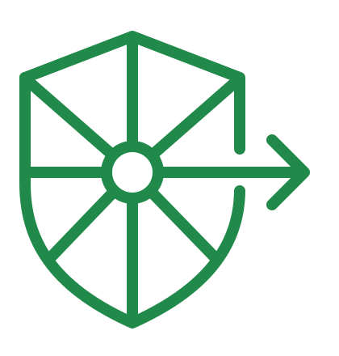

<div align="center">

#  OpenPhalanx

**A private AI coding agent on your own GPU**

[](LICENSE)
[](https://github.com/chophilip21/openPhalanx/releases)


Run a coding model on your own Linux GPU machine and use it from any laptop on your network. The coding agent runs on the laptop next to your repo; the server only answers prompts and stores no code.

[🚀 Quick Start](#quick-start) • [📖 Developer docs](CLAUDE.md) • [⭐ GitHub](https://github.com/chophilip21/openPhalanx)

</div>

---

## Why OpenPhalanx?

* ✅ **Private**: your repo, tests and git stay on your laptop. Prompts go only to your own server, over TLS pinned to its certificate, and the server keeps no code.
* ✅ **Models that fit**: the app shows which models fit your GPU, counting the KV cache and runtime memory, not just the download size.
* ✅ **Whole-repo agent**: the agent reads your files on demand and runs your own tests and commands (after asking). Add tools from any MCP server (GitHub, a database, a browser…) as connectors; you approve each call.
* ✅ **Managed context**: when a conversation grows, older content is trimmed or summarized automatically.
* ✅ **Web search**: the server searches the web through its own private SearXNG when a request needs current information.
* ✅ **Clusters**: servers on one network can form a cluster and split a model too big for one GPU across them.

## Quick Start

Every GPU machine needs Linux, a working `nvidia-smi` (24 GB or above VRAM recommended, 8GB absolute minimum), Docker (your user in the `docker` group) and the [NVIDIA Container Toolkit](https://docs.nvidia.com/datacenter/cloud-native/container-toolkit/latest/install-guide.html). The installers check these first.

### A. One GPU machine with a desktop (the app)

```bash
curl -fsSL https://github.com/chophilip21/openPhalanx/releases/latest/download/install-server.sh | sh
```
1. Open **Openphalanx**. On **Models**, pick a model marked **Fits** and click **Download**.
2. On **Server**, press the power button. The first start downloads the server image (16 GB, once); loading a model takes 3–4 minutes.
3. When the button is green, a **pairing code** appears. Open port `9090/tcp` to your laptops and go to [Laptop](#laptop-linux-or-macos).

### B. One GPU machine without a desktop (`oppxs`)

```bash
curl -fsSL https://github.com/chophilip21/openPhalanx/releases/latest/download/install-server.sh | sh -s -- --headless
systemctl --user enable --now oppxs    # the server process; keeps running
oppxs models                           # what fits this GPU
oppxs download <model> && oppxs use <model>
oppxs start                            # serves the model; `oppxs stop` to stop
oppxs pair                             # prints the pairing code for a laptop
```

### C. Several GPU machines as one (a model too big for one GPU)

One machine is the **host**: you start the model there and laptops pair with it. It must run **the app** (A). Every other machine is a **member**: install the app, or `oppxs` with the first command of B. All on the same version and the same wired network.

| Step | On the host (app, **Server** page) | On each member |
|---|---|---|
| 1 | | Open the app, or `systemctl --user enable --now oppxs` |
| 2 | Under **Servers on this network**, click **Add to cluster** | |
| 3 | | Click **Approve** in the app, or run `oppxs approve` |
| 4 | Pick the model on **Models** (it now counts every machine's VRAM) | |
| 5 | Press the power button. If a member lacks the model, click **Download on <its name>** | Nothing: it starts its share by itself |

Between the machines, allow `9092/tcp`, `9093/udp` and `9100–9116/tcp`, and keep them on a network you trust. `oppxs status` on a member shows its host and anything waiting for approval; `oppxs leave` takes it out again. A machine that doesn't show up usually has a second server process holding its ports (the app and `oppxs` can't both run): `oppxs free-ports`, or **Free the ports** in the app, stops the leftover.

### Laptop (Linux or macOS)

```bash
curl -fsSL https://github.com/chophilip21/openPhalanx/releases/latest/download/install.sh | sh
oppx pair 192.168.1.77 ABCD-EFGH  # the host's address and pairing code (on the server itself: oppx pair self)
oppx status                       # certificate, device and model all ✓
```

`oppx pair` prints the server's certificate fingerprint; check it matches the one in the app (or `oppxs pair`). Then, in any git repo:
```bash
oppx                              # start a conversation
oppx "fix the failing test"       # start with a request
oppx -c                           # continue the last conversation (-r to pick an older one)
oppx -p "explain src/main.rs"     # answer once and exit
oppx --update                     # update oppx and its engine
oppx mcp add <name> -- <command>  # add an MCP server's tools (/mcp in the chat)
oppx browser on | off             # headless browser for web UIs: start with every chat, or ask once (default)
```

Edits are never committed: review them with `git diff` and commit yourself. `oppx unpair` removes a laptop (or revoke it on the app's **Devices** page).

## Keys in the chat

**Shift+Tab** plan mode (no edits) · **Esc** interrupt · **Ctrl-C** twice exits · **@file** add a file · **!cmd** run a command · **# note** save to project memory · **/help** all commands

## Connect tools with MCP

Connectors are [MCP](https://modelcontextprotocol.io) servers whose tools the agent can call, such as Linear, GitHub or a database. They run on your laptop with your own credentials; the server never sees them, and you approve each call (`y`, `N`, or `a` for always this session).

```bash
oppx mcp add <name> -- <command> [args]                  # a local server (stdio)
oppx mcp add <name> --url <https://…> -H 'Name: value'   # a remote server (streamable HTTP)
oppx mcp list                                            # what's added; /mcp in the chat
oppx mcp remove <name>
```

Example, [Linear](https://linear.app), with a personal API key (Settings → Account → Security & access):
```bash
export LINEAR_API_KEY=lin_api_...
oppx mcp add linear --url https://mcp.linear.app/mcp -H 'Authorization: Bearer ${LINEAR_API_KEY}'
```
Keep the single quotes: the key is read from your environment at start and never written to the config. For a browser login instead (needs Node): `oppx mcp add linear -- npx -y mcp-remote https://mcp.linear.app/mcp`. Then ask in the chat, e.g. "list my open Linear issues".

Every connector's tool list is sent with each request, so add only what you use; `oppx mcp add` prints the cost and warns when the server's model has a small context window. `--project` saves a connector in the repo's `.mcp.json` (it asks before running one from a cloned repo).

## From source

Needs Rust, Node.js 20+ and the WebKitGTK packages listed in [CLAUDE.md](CLAUDE.md). Testing and the rules for changes are in [CONTRIBUTING.md](CONTRIBUTING.md).
```bash
git clone -b dev https://github.com/chophilip21/openPhalanx.git && cd openPhalanx
(cd app && npm install && npx tauri dev)    # server app
cargo install --path client/oppx && cargo install --path crates/openphalanx-server   # oppx (client), oppxs (server command)
```

## Contributing

Contributions are welcome. The pull request workflow, PR title prefixes and review rules are in [CONTRIBUTING.md](CONTRIBUTING.md).

By contributing, you agree that your contributions will be licensed under the project's **GNU General Public License v3.0 (GPLv3)**.

## Learn more

* **[CLAUDE.md](CLAUDE.md)** (architecture, security model, clusters, connectors, troubleshooting) · **[Releases](https://github.com/chophilip21/openPhalanx/releases)** (downloads and changelog)
